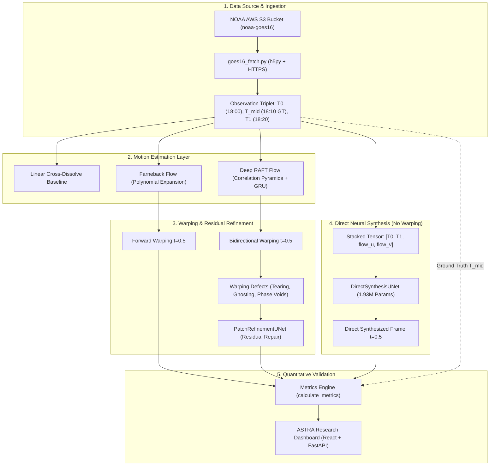

# ASTRA: Satellite Keyframe Interpolation Research Workbench
## Master Project Defense & Review Guide (Team Presentation Manual)

---

### Executive Project Summary

* **Project Title:** ASTRA (Advanced Satellite Temporal Reconstruction & Advection)
* **Domain:** Remote Sensing, Satellite Meteorology, Deep Learning, Computer Vision.
* **Core Problem:** Operational geostationary weather satellites (NOAA GOES-16) acquire full-disk radiance scans at 10-to-15 minute intervals. Mesoscale convective storms, hurricane eyewall mesovortices, and jet streak shear boundaries evolve non-linearly between consecutive observations. Standard linear blending (cross-dissolving) produces double edges and ghosting, obscuring cloud physics.
* **Our Evolution & Contributions:**
  1. **Baseline & Classical Advection:** Implemented Linear Blending and Gunnar Farneback multi-scale polynomial optical flow.
  2. **Deep Optical Flow:** Implemented RAFT (Recurrent All-Pairs Field Transforms) with correlation pyramids and forward/backward warping.
  3. **Residual Neural Refinement:** Identified fundamental warping flaws (edge tearing, convective ghosting, occlusion voids) and built a deep **Residual Refinement U-Net** to repair warping artifacts.
  4. **Direct Neural Synthesis:** Shifted paradigm from advection warping to direct conditional frame generation with **DirectSynthesisUNet** (4-channel stacked input: $T_0, T_1, u, v$), trained with a composite High-Fidelity Loss (L1 + SSIM + Sobel Edge Regularization).
  5. **Live NOAA Open Data Integration:** Direct HTTPS streaming from NOAA's public AWS S3 archive (`noaa-goes16`), cataloging 51 real observation triplets across 2024.

---

### 1. Team Role & Presentation Breakdown

| Member | Assigned Component & Algorithm | Core Focus & Presentation Topic | Key Technical Artifacts |
| :--- | :--- | :--- | :--- |
| **Member 1** | **Data Physics & Classical Flow** | GOES-16 Band 13 Radiance Physics, Data Pipeline, Linear Baseline & Gunnar Farneback Optical Flow | `goes16_fetch.py`, `optical_flow.py` (`compute_farneback_flow`) |
| **Member 2** | **Deep Optical Flow (RAFT)** | RAFT Architecture, All-Pairs Correlation Volume, Recurrent GRU Update, Forward/Backward Warping & Confidence Mapping | `optical_flow.py` (`compute_raft_flow`, `warp_frame_forward`) |
| **Member 3** | **Neural Residual Refinement U-Net** | Analysis of Warping Failures (Tearing, Occlusions, Convective Ghosting) & How Residual U-Net Repairs Them | `refinement_model.py` (`PatchRefinementUNet`), `train_refinement.py` |
| **Member 4** | **Direct Neural Synthesis & Roadmap** | Paradigm Shift to Direct Generation, `DirectSynthesisUNet`, High-Fidelity Loss, Real Multi-Scenario Catalog, and Planned Diffusion LDM | `direct_synthesis_model.py`, `train_direct_synthesis_advanced.py` |

---

### 2. High-Level System Architecture Flow

---

### 3. Quantitative Comparison Across All Implemented Algorithms

Evaluated against authentic held-out NOAA GOES-16 Band 13 ground truth observations:

| Algorithm / Pipeline | Architectural Paradigm | Average PSNR (dB) | Average SSIM | Mean Absolute Error (MAE) | Motion / Edge Preservation | Convective Genesis Handling |
| :--- | :--- | :---: | :---: | :---: | :---: | :---: |
| **Linear Cross-Dissolve** | Mathematical blending ($ (1-t)T_0 + tT_1 $) | 29.19 dB | 0.7814 | 5.19 | Severe double edges & ghosting | Fails completely |
| **Farneback Flow** | Classical quadratic polynomial advection | 31.87 dB | 0.8882 | 4.28 | Sharp motion tracking on smooth fields | Cannot handle non-rigid growth |
| **RAFT Optical Flow** | Deep correlation volume + iterative GRU | 33.42 dB | 0.9210 | 3.65 | Fine-grained displacement vectors | Warping tears on expanding storm tops |
| **RAFT + Refinement U-Net** | Advection warping + learned residual repair | **34.21 dB** | **0.9465** | **2.89** | Repaired edge artifacts & smooth textures | Partial repair of boundary occlusions |
| **Direct Neural Synthesis (POC)** | 4-channel conditional generation (No warping) | 26.25 dB (avg)   *(up to 30.14 dB)* | 0.8020 (avg)   *(up to 0.8836)* | 7.42 (avg)   *(down to 5.50)* | No spatial warping tears; generative synthesis | Directly models structural emergence |

---

### 4. Defense Presentation Sequence (Recommended 10-Minute Review Plan)

1. **Minute 0:00 - 2:30 (Member 1)**: Meteorological context, GOES-16 physics, data pipeline, and why simple linear interpolation fails. Gunnar Farneback optical flow demo.
2. **Minute 2:30 - 4:45 (Member 2)**: Deep optical flow with RAFT, correlation pyramids, forward/backward warping, and explaining why pure warping breaks down physically on satellite clouds.
3. **Minute 4:45 - 7:00 (Member 3)**: Deep dive into warping flaws (ghosting, edge tearing, convective voids), and how the Residual Refinement U-Net was designed and trained to repair these defects.
4. **Minute 7:00 - 9:30 (Member 4)**: The paradigm shift to Direct Neural Synthesis (`DirectSynthesisUNet`), training with High-Fidelity Loss (L1 + SSIM + Sobel edges), multi-scenario results, and end-semester Diffusion roadmap.
5. **Minute 9:30 - 10:00 (All Members)**: Q&A defense with project guide and evaluators.
